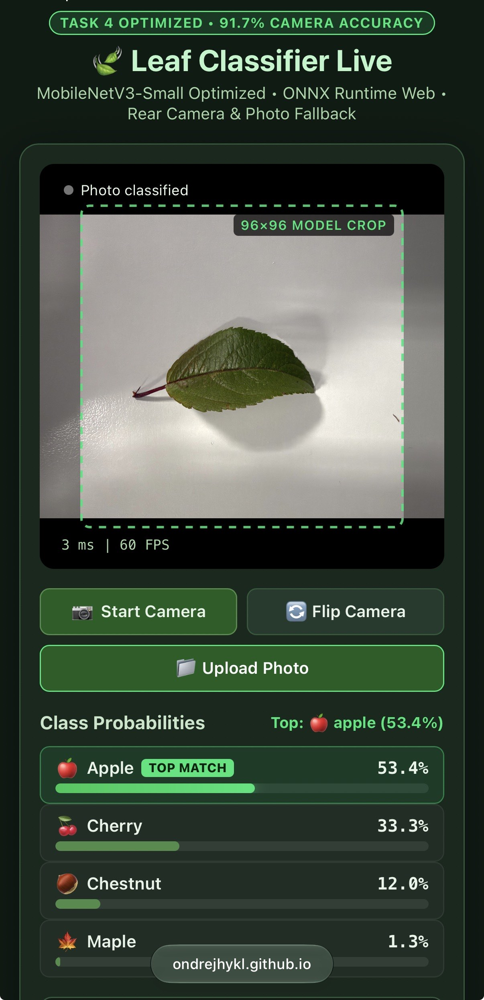

# Task 4 – Leaf Classifier Optimization

## 1. Dataset and Experimental Setup

The classifier was trained on an expanded dataset combining last year's dataset with additional images collected by Group 2, resulting in 868 leaf images belonging to four classes: apple (218), cherry (216), chestnut (210) and maple (224).

The models were evaluated on two fixed validation datasets:
- **Clean validation set:** 120 original images (30 per class).
- **Camera-like validation set:** 120 transformed images with random crops, rotations, perspective shifts and colour variations.

Each of the 10 configurations was trained using three random seeds (42, 123 and 456). Results are reported as mean accuracy ± standard deviation.

## 2. Experiment Results

| Configuration | Main modification | Clean accuracy (%) | Camera-like accuracy (%) |
|---|---|---:|---:|
| Baseline LeafNetBN | Original custom CNN | 83.61 ± 0.48 | 61.39 ± 1.27 |
| Colour Augmentation | ColorJitter | 78.33 ± 2.50 | 70.00 ± 5.77 |
| Dropout | Dropout (p = 0.3) | 85.00 ± 2.89 | 63.61 ± 3.47 |
| Global Average Pooling | Adaptive average pooling | 82.50 ± 0.83 | 56.67 ± 6.01 |
| AdamW | Weight decay = 0.01 | 83.05 ± 0.48 | 62.78 ± 6.47 |
| Label Smoothing | Label smoothing = 0.1 | 83.06 ± 1.27 | 66.67 ± 3.63 |
| MobileNetV3 Frozen | Frozen pretrained feature extractor | 77.78 ± 2.10 | 69.72 ± 2.55 |
| MobileNetV3 Fine-tuned | Fine-tuning all layers | 93.33 ± 0.84 | 87.22 ± 0.96 |
| **Improved MobileNetV3** | Fine-tuning + ColorJitter + AdamW + cosine scheduler + label smoothing | **91.94 ± 0.96** | **90.56 ± 1.27** |
| Combined LeafNetBN | Combination of regularization techniques | 73.06 ± 1.73 | 69.72 ± 1.27 |

## 3. What Worked and What Did Not

The most effective improvement was **transfer learning with full fine-tuning of MobileNetV3-Small**. It substantially improved both clean and camera-like accuracy.

Colour augmentation and label smoothing also improved camera-like accuracy individually. Dropout and AdamW provided only small improvements. Global average pooling and combining regularization techniques in LeafNetBN reduced performance.

Small differences should be interpreted carefully because each validation dataset contains only 120 images and each configuration was repeated with three seeds.

## 4. Selected Model

The selected model is **Improved MobileNetV3-Small**, achieving:
- Clean validation accuracy: **91.94%**
- Camera-like validation accuracy: **90.56% ± 1.27%**

Compared to the baseline camera-like accuracy of 61.39%, this is an improvement of **29.17 percentage points**.

It was selected because it achieved the best camera-like accuracy while maintaining high clean accuracy. The model was exported to ONNX and tested in the course mobile application.

## 5. Mobile Application Test

The selected ONNX model was successfully tested in the course camera application on a mobile phone. It classified leaf images and displayed class probabilities.

**Mobile application screenshot:**

