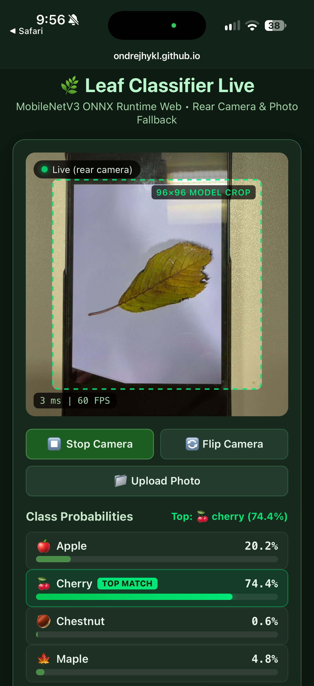

# REVIEW MLR_ex08

## Task 2:

### 1. It runs on my phone:
I opened the GitHub Pages application on my phone, allowed camera access and tested leaf classification. The camera and classification worked. No fixes were necessary.

### 2. The same numbers as the notebook:
I ran the verification. The predicted probabilities matched check_expected.json to three decimal places. The test passed.

### 3. The preprocessing matches your model:
I checked the preprocess() function in index.html. It crops the central square, resizes it to 96 × 96 pixels, divides RGB values by 255 and standardizes them using the specified mean and standard deviation. The channels are ordered RGB and the input tensor has shape [1, 3, 96, 96]. These settings correspond to the model configuration. No fixes were necessary.

### 4. Nothing leaves the phone
Image preprocessing and model inference run locally in the browser using ONNX Runtime Web. Camera frames and uploaded images are not sent to an external server. The application downloads the model, configuration and verification files from GitHub Pages, while ONNX Runtime Web and the QR generator library are loaded from jsDelivr. No fixes were necessary.
